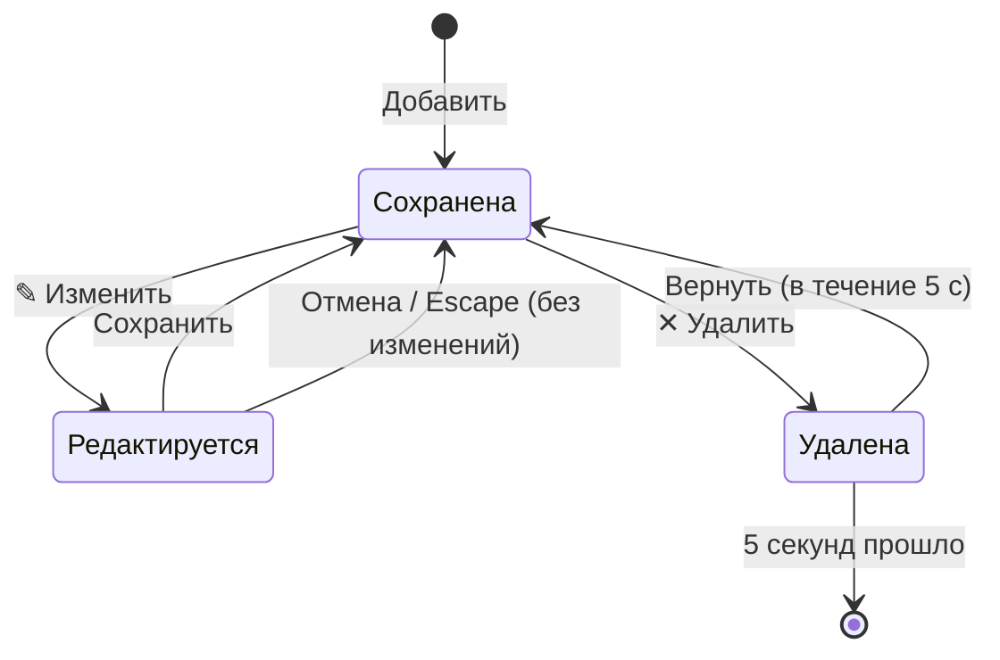

# Тест-дизайн

Как выбраны проверки: для каждой важной функции — техника тест-дизайна, которая даёт наибольшее покрытие наименьшим числом тестов. Рядом указано, где проверка автоматизирована.

## 1. Сумма операции — классы эквивалентности и граничные значения

Требование [REQ-02](requirements.md): сумма от 0,01 до 1 000 000 000 ₸, не больше двух знаков после запятой.

**Классы эквивалентности**

| Класс | Пример | Ожидание |
| --- | --- | --- |
| Целое число в диапазоне | `4500` | принимается |
| С разделителем разрядов | `12 500` | принимается как 12 500 ₸ |
| Дробь через запятую | `4500,50` | принимается |
| Дробь через точку | `4500.5` | принимается как 4 500,50 ₸ |
| Пустое поле / только пробелы | ``, `   ` | «Введите сумму» |
| Не число | `сто`, `abc`, `1e5` | «Сумма — это число…» |
| Отрицательное число | `-100` | «Сумма — это число…» (знак задаётся типом операции) |
| Больше двух знаков после запятой | `10,555` | «Сумма — это число…» |
| Ноль | `0`, `0,00` | «Сумма должна быть больше нуля» |
| Больше максимума | `1000000000,01` | «Сумма не может быть больше 1 000 000 000 ₸» |

**Граничные значения**

```
        0 ─────── 0,01 ─────────────── 1 000 000 000 ─────── 1 000 000 000,01
     отказ      минимум                    максимум                отказ
```

| Значение | Ожидание |
| --- | --- |
| `0` | отказ: ноль |
| `0,01` | принимается — минимальная сумма |
| `1000000000` | принимается — максимальная сумма |
| `1000000000,01` | отказ: больше максимума |

Автоматизация: все классы и границы — юнит-тесты `tests/unit/money.test.js`; по одному представителю каждого класса ошибок — E2E «ошибка ввода: …» в `tests/e2e/transactions.spec.js`.

## 2. Дата операции — граничные значения

Требование [REQ-03](requirements.md): дата не позже сегодня.

| Значение | Ожидание |
| --- | --- |
| вчера | принимается |
| сегодня | принимается — граница |
| завтра | «Дата не может быть в будущем» |
| пустое поле | «Укажите дату» |

Для импорта дополнительно проверяется существование даты: `2026-02-29` (невисокосный год), `2026-04-31`, `2026-13-01` — отклоняются ([REQ-24](requirements.md)), юнит-тесты `dates.test.js` и `csv.test.js`.

## 3. Статус бюджета — граничные значения

Требование [REQ-17](requirements.md). Пример: лимит 10 000 ₸.

| Потрачено | Доля | Статус |
| --- | --- | --- |
| 7 999 ₸ | 79,99 % | норма |
| 8 000 ₸ | 80 % | предупреждение — нижняя граница |
| 10 000 ₸ | 100 % | предупреждение — верхняя граница, «осталось 0 ₸» |
| 10 001 ₸ | 100,01 % | перерасход 1 ₸ |

Автоматизация: юнит-тесты `budgetStatus` в `stats.test.js` (ровно 80 % — предупреждение), E2E «бюджеты показывают статус и перерасход».

## 4. Сравнение с прошлым месяцем — таблица решений

Требование [REQ-13](requirements.md).

| | Правило 1 | Правило 2 | Правило 3 | Правило 4 |
| --- | --- | --- | --- | --- |
| Расходы в текущем месяце есть | нет | да | да | да |
| Расходы в прошлом месяце есть | — | нет | да | да |
| Текущий месяц ещё идёт | — | — | да | нет |
| **Результат** | не показывать | не показывать | сравнить с теми же днями прошлого месяца | сравнить с прошлым месяцем целиком |

Автоматизация: юнит-тесты `expenseTrend` (правила 2, 3, 4), E2E «пример данных: итоги и сравнение…» (правило 3).

## 5. Жизненный цикл операции — переходы состояний

Требования [REQ-01](requirements.md), [REQ-07](requirements.md), [REQ-08](requirements.md).



| Переход | Тест |
| --- | --- |
| Добавить | E2E «расход добавляется в список и в итоги месяца» |
| Изменить → Сохранить | E2E «операция редактируется, итоги пересчитываются» |
| Изменить → Escape | E2E «Escape отменяет редактирование без изменений» |
| Удалить → Вернуть | E2E «удалённую операцию можно вернуть» |
| Удалить → истекло время | ручная проверка ([чек-лист](checklists.md)) |
| Редактируется → Удалить ту же операцию | ручная проверка: редактирование отменяется, операция удаляется |

## 6. Импорт CSV — классы корректных и некорректных строк

Требование [REQ-24](requirements.md).

| Класс строки | Пример | Ожидание |
| --- | --- | --- |
| Корректная строка, русский файл | `2026-11-01;Расход;Продукты;-1000.00;ок` | загружается |
| Корректная строка, английский файл | `2026-11-01;Expense;Groceries;-1000.00;ok` | загружается |
| Значение с `;` и кавычками | `"Обед; с ""коллегами"""` | загружается целиком |
| Несуществующая дата | `2026-02-30` | пропускается |
| Дата в будущем | `2099-01-01` | пропускается |
| Неизвестный тип | `Перевод` | пропускается |
| Категория другого типа | `Расход;Зарплата` | пропускается |
| Неверная сумма | `сто` | пропускается |
| Заголовок | `Дата;Тип;…` | не считается строкой с ошибкой |
| Файл без операций | любой текст | «В файле не нашлось ни одной операции» |

Автоматизация: каждый класс — юнит-тесты `csv.test.js`; полный цикл экспорт → очистка → импорт и импорт файла с ошибкой — E2E в `analytics.spec.js`.

## 7. Окружение — попарное тестирование

Факторы: тема (светлая, тёмная) × язык (RU, EN) × устройство (компьютер, телефон). Все сочетания — 8, попарное покрытие — 4:

| № | Тема | Язык | Устройство |
| --- | --- | --- | --- |
| 1 | светлая | RU | компьютер |
| 2 | тёмная | EN | компьютер |
| 3 | светлая | EN | телефон |
| 4 | тёмная | RU | телефон |

Каждая пара значений встречается хотя бы один раз. Сочетания 1 и 3 частично автоматизированы, все четыре проходятся вручную по смоук-чек-листу перед релизом.
